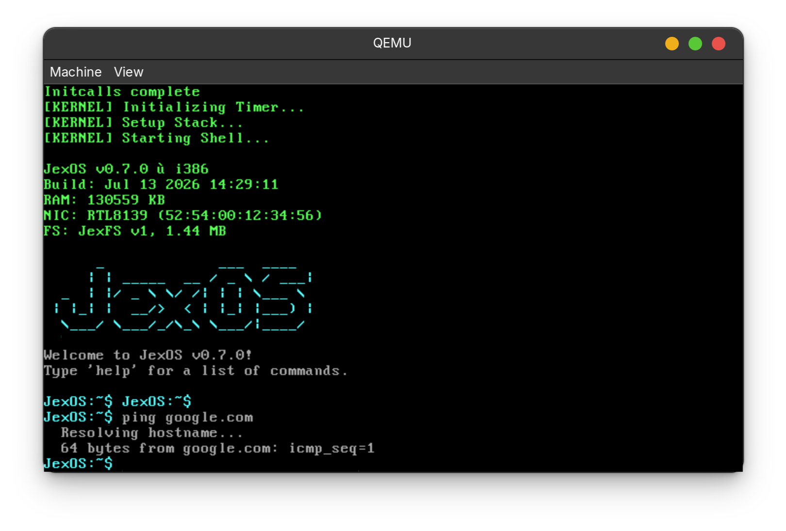

# JexOS

A 32-bit x86 hobby OS written from scratch: freestanding C,
a full network stack, multitasking, a persistent filesystem, and a
self-hosting TCC compiler.

## Screenshots




## Features

- **Network stack** — ARP, IP, ICMP, UDP, TCP from scratch; RTL8139 driver
  (DMA ring buffer, interrupt-driven)
- **HTTP** — `serve` (TCP server) and `fetch` (client); DHCP and DNS clients
- **Compiler** — self-hosting TCC with `if`/`else`, `while`, `for`, and hex printing
- **Filesystem** — JexFS on a 1.44 MB floppy; flat root layout, proper errno codes
- **Multitasking** — round-robin scheduler, `fork`/`waitpid`, signals, per-process page tables
- **Shell** — tab completion, persistent history, `ps`/`kill`/`top`, vix editor
- **Debugging** — panic screen with register dump and stack trace, `dmesg`,
  GDB stub, ftrace-lite, lockdep

## Build & Run

```bash
make          # build kernel + disk image
make run      # launch in QEMU (GUI mode)
```

Requires `gcc` (i386 cross), `nasm`, `qemu-system-i386`.

## Roadmap

- [x] Self-hosting TCC
- [x] TCP server (passive open)
- [ ] Pipes & redirection
- [ ] SMP

## Status

v0.7.0: TCC self-hosting, control flow, flat filesystem. TCC is experimental
and buggy — report any that you find.

## Contributing

Educational project. Network protocol bugs, driver improvements, and shell
features are all welcome.
