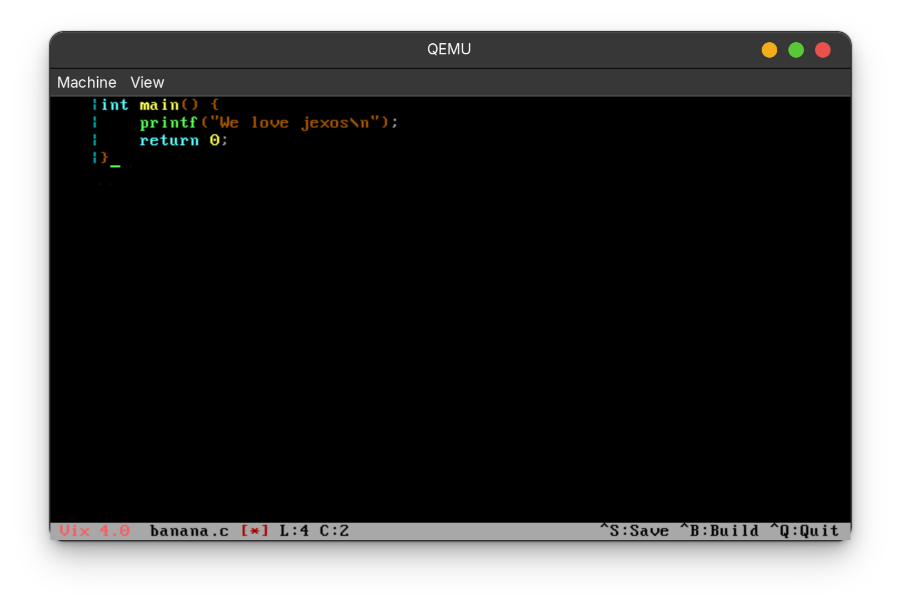

# JexOS

A 32-bit x86 hobby OS written from scratch: freestanding C,
a full network stack, multitasking, a persistent filesystem, and a
self-hosting TCC compiler.

## Screenshots




## Features

- **Network stack** — ARP, IP, ICMP, UDP, TCP from scratch; RTL8139 driver
  (DMA ring buffer, interrupt-driven)
- **HTTP** — `serve` (TCP server) and `fetch` (client); DHCP and DNS clients
- **Compiler** — self-hosting TCC with `if`/`else`, `while`, `for`, and hex printing
- **Filesystem** — JexFS on a 1.44 MB floppy; flat root layout, proper errno codes
- **Multitasking** — round-robin scheduler, `fork`/`waitpid`, signals, per-process page tables
- **SMP** — boots both CPUs via ACPI MADT discovery and INIT-SIPI; per-CPU
  run queues, IOAPIC interrupt routing, calibrated AP bring-up timing
- **Shell** — tab completion, persistent history, `ps`/`kill`/`top`, vix editor
- **Debugging** — panic screen with register dump and stack trace, `dmesg`,
  GDB stub, ftrace-lite, lockdep

## Build & Run

```bash
make              # build kernel + disk + boot image
make run          # boot in QEMU via GRUB (default)
make run-native   # boot via the custom two-stage bootloader
make iso          # build the GRUB ISO only
```

Boots with GRUB by default, which gives the kernel a proper memory map
and keeps the JexFS data disk on hda. `make run-native` instead boots
through JexOS's own stage-1/stage-2 bootloader
(BIOS → bootsect → loader → protected mode).

Requires `gcc` (i386), `binutils`, `python3`, `grub2-tools`, and
`qemu-system-i386`.

## Roadmap

- [x] Self-hosting TCC
- [x] TCP server (passive open)
- [x] SMP
- [ ] Pipes & redirection
- [ ] SMP locking audit (spinlocks for shared kernel structures)

## Status

master: two CPUs out of the box. ACPI RSDP/MADT parsing brings up the
AP through a real-mode trampoline, the IO/APIC owns interrupt delivery
(PCI INTx routed via PIRQ cookies), and each CPU runs its own ready
queue. Along the way this fixed a subtle QEMU quirk where PIT ticks
arrive on the cascade line — and double-deliver in square-wave mode —
so the clock now runs in rate-generator mode with a boot-time self-test
that verifies delivered ticks against an independent stopwatch.

v0.7.4: boot via GRUB by default (custom two-stage loader kept as
`make run-native`), no hardcoded RAM cap (bitmap covers the full 4GB
address space), and `free`/memory stats report the RAM actually
detected by the bootloader instead of nonsense.

v0.7.0: TCC self-hosting, control flow, flat filesystem. TCC is experimental
and buggy — report any that you find.

## Contributing

Educational project. Network protocol bugs, driver improvements, and shell
features are all welcome.
